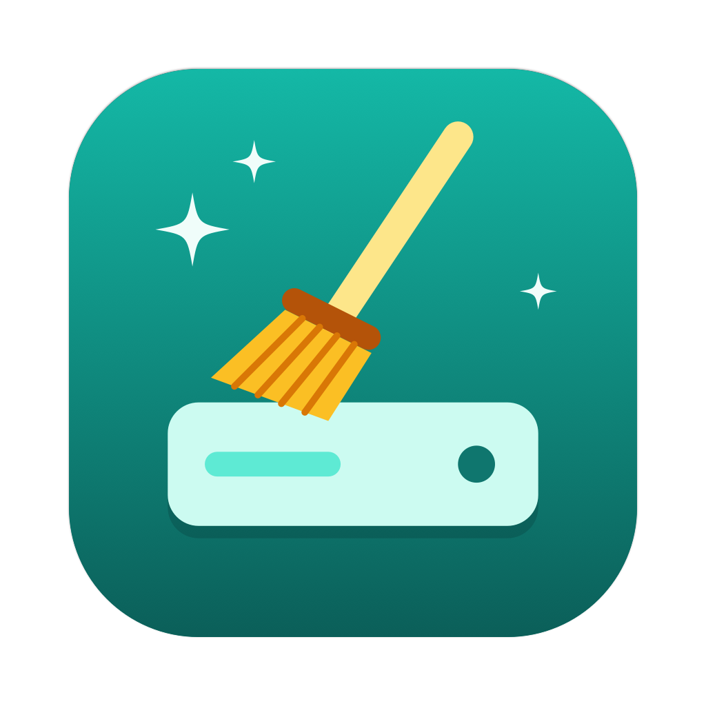
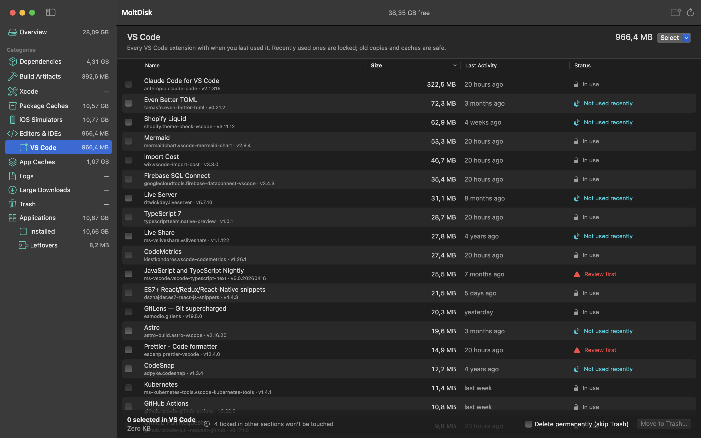

<p align="center">
  
</p>

<h1 align="center">MoltDisk</h1>

<p align="center"><b>The Mac cleaner made for developers.</b><br>
Find the space your dev tools quietly eat, and clean it safely.</p>

<p align="center">macOS 15 or later · Apple silicon · native SwiftUI<br>
<a href="https://moltdisk.vercel.app">moltdisk.vercel.app</a> · <a href="LICENSE.md">source-available, noncommercial</a></p>



MoltDisk scans a developer Mac for reclaimable space (`node_modules` and build folders in any language, package caches, Xcode data, old simulators, unused editor extensions, app caches, logs) and groups it by category with sizes and a safety label on every item. It deletes only what you tick, after a confirmation sheet showing the total, and moves things to the Trash by default.

## Highlights

- **Every project, every language.** JS, Python, Java/Spring, Rust, .NET, Swift, Flutter, Elixir and more. Generic names like `build` or `dist` only count when the project file next to them proves it.
- **Old simulators and runtimes**, removed with `xcrun simctl`, the way Xcode does it.
- **Editor extensions by real use.** VS Code, Cursor, Windsurf, Antigravity, Kiro and other VS Code-based editors, plus JetBrains IDEs. Extensions you used recently are locked.
- **Running apps stay locked.** Caches of open apps can't be ticked, and MoltDisk checks again right before it deletes.
- **Trash first.** Permanent delete is an explicit checkbox.

## Install

Paste this in Terminal:

```bash
curl -fsSL https://moltdisk.vercel.app/install.sh | sh
```

It downloads the latest release from GitHub, puts `MoltDisk.app` in Applications (or `~/Applications` if you can't write to `/Applications`) and opens it. Run it again any time to update. Read the script first if you like: [`landing/install.sh`](landing/install.sh).

Or with [Homebrew](https://brew.sh):

```bash
brew tap joe-watson-dev/moltdisk https://github.com/joe-watson-dev/moltdisk && brew trust joe-watson-dev/moltdisk && brew install --cask moltdisk
```

Homebrew asks you to trust a tap before it runs an outside recipe; `brew trust` does that for this one. Both commands always install the **latest** release. To update later, run the curl command again, or `brew upgrade --cask --greedy moltdisk` (the cask tracks the newest release, so Homebrew needs `--greedy` to reinstall it).

**Why a Terminal command?** MoltDisk isn't signed by Apple yet (that needs a paid Apple Developer account). When you download an unsigned app in a browser, macOS tags it as coming from the internet and blocks it as being from an *unidentified developer*. A download made with `curl` isn't tagged, and the Homebrew cask removes the tag after installing, so the app opens normally. Everything it runs is in this repository.

Requirements: a Mac with **Apple silicon** (M1 or newer) and **macOS 15 Sequoia** or later. The script checks both and stops with a clear message otherwise.

<details>
<summary>Other ways to install</summary>

- **Downloaded in the browser and macOS blocks it?** Move `MoltDisk.app` to Applications, then run:

  ```bash
  xattr -dr com.apple.quarantine /Applications/MoltDisk.app
  ```

  This also fixes "MoltDisk is damaged and can't be opened". Or try to open the app once, then go to **System Settings › Privacy & Security** and click **Open Anyway** (needs an admin account).
- **Build it yourself** (needs Xcode or the Command Line Tools; apps you build are never blocked):

  ```bash
  git clone https://github.com/joe-watson-dev/moltdisk && cd moltdisk && ./scripts/build-app.sh && open build/MoltDisk.app
  ```

Work Macs managed by a company may block unsigned apps completely; only a notarized build gets past that.
</details>

To read the Trash and remove other apps' containers, grant **Full Disk Access** in System Settings › Privacy & Security.

## Build from source

```bash
./scripts/build-app.sh          # builds build/MoltDisk.app (release, ad-hoc signed)
open build/MoltDisk.app
```

Or open `Package.swift` in Xcode and press Run. `swift run MoltDisk` works too.

`swift run MoltDisk --report` prints the scan to the terminal without opening a window.

The app icon (a broom sweeping a drive) is drawn in code by `scripts/make-icon.swift`, which writes `Resources/AppIcon.icns`; `build-app.sh` bundles it. Rerun the script after tweaking colors or shapes.

## What it scans

| Category | Where | Label |
|---|---|---|
| Dependencies | `node_modules`, Python virtualenvs (any folder with `pyvenv.cfg`), Composer `vendor`, `Pods`, Carthage, Elixir `deps`, `.tox`, `.terraform`, project-local `.pnpm-store` | Will need reinstall |
| Build artifacts | JS (`.next`, `.turbo`, `.expo`, `.nuxt`, `.svelte-kit`, `.angular`, `dist`, `build`, `out`, `coverage`…), Python (`__pycache__` grouped per project, `.pytest_cache`, `.mypy_cache`, `.ruff_cache`, `*.egg-info`, `dist`), Java/Spring Boot (Maven `target`, Gradle `build` + `.gradle`), Rust `target`, .NET `bin`/`obj`, SwiftPM `.build`, Xcode, Flutter `build` + `.dart_tool`, Elixir `_build`, Haskell, Zig, CMake, Rails `tmp`, Unity `Library`/`Temp` | Safe, or Review first when a generic name like `build`/`bin` isn't gitignored |
| Xcode | DerivedData, Archives, DeviceSupport, SwiftUI Previews | Safe / Review |
| Package caches | npm, npx, pnpm (old store versions; the live store is locked), Yarn, Bun, Homebrew, CocoaPods, Gradle, Maven `~/.m2`, NuGet, pub, Composer, Go modules, Cargo, pip, SwiftPM, Deno, `~/.cache/*` | Safe |
| iOS Simulators | devices and runtimes from `xcrun simctl` | Will need reinstall (unavailable devices: Safe) |
| Editors & IDEs | Each editor found on the Mac gets its own sidebar entry. **VS Code family** (VS Code, Insiders, VSCodium, Cursor, Windsurf, Antigravity, Kiro, Trae, Positron, Void): every extension with its real name and whether you use it (see below), old duplicate versions, editor caches. **JetBrains** (IntelliJ, WebStorm, PyCharm, GoLand, Rider…) and **Android Studio**: old versions left after upgrades (caches + settings + plugins + logs), plus the current version's caches and logs. The current version's settings are never offered | Locked / Not used recently / Review / Safe |
| App caches | `~/Library/Caches/*`, Chrome/Brave/Edge/Arc and Electron app caches (Slack, Discord, Cursor, Notion…) inside Application Support, optionally sandboxed app caches in `~/Library/Containers` (Settings) | Safe (`com.apple.*`: Review) |
| Logs | `~/Library/Logs/*` | Safe |
| Large downloads | items over 100 MB in `~/Downloads` | Review |
| Trash | `~/.Trash` (needs Full Disk Access to read) | Review |
| Applications | **Installed:** every app in `/Applications` (and one folder deep) and `~/Applications`, with the files it keeps in `~/Library`: Application Support, Caches, Logs, Containers, Group Containers, Preferences (incl. ByHost), Saved Application State, HTTPStorages, WebKit, Cookies, Application Scripts and LaunchAgents. **Leftovers:** the same kinds of files from apps that are no longer on the Mac, one row per developer | Will need reinstall / Not used recently (90 days) / Review (leftovers) |

Projects are searched in `~/DEV`, `~/Developer`, `~/Projects`, `~/code`… by default; change them in **Settings › Project folders** (⌘,).

### How extension usage is detected (VS Code, Cursor, Windsurf, Antigravity…)

- **Activations:** VS Code's extension-host logs record each extension it activates and why. MoltDisk saves them per editor in `~/Library/Application Support/MoltDisk/` (e.g. `vscode-usage.json`, `cursor-usage.json`), so the history keeps growing after VS Code rotates its logs.
- **Storage:** activity in each extension's `globalStorage` and `workspaceStorage` folders also counts as use.
- **Locked:** extensions used in the last 30 days, installed in the last 14 days, needed by an extension you use, or providing your active color/icon theme.
- **Review first:** extensions that load at every VS Code startup (so real use can't be told apart), and snippet/grammar/theme-only extensions (VS Code never logs those).
- **Not used recently:** no activation and no storage activity in 30 days. Use **Select › Not used recently** to tick them all.

## Selection

Cleaning only acts on items ticked **in the section you're viewing**. Ticks you made in other sections stay, but are never included; the bottom bar shows how many there are. Overview shows everything, so cleaning from Overview includes every ticked item.

## Safety

- **Trash by default.** Items are moved to the Trash; "Delete permanently" is an explicit checkbox.
- **Simulators** are removed with `xcrun simctl delete` / `simctl runtime delete`, never `rm`.
- **Running apps are locked.** Caches, logs and data whose owner app is running (matched by bundle ID or name) show as *In use* and can't be selected. This is checked again just before deleting. Booted simulators and the live pnpm store are locked too.
- **Uninstalling apps** has its own, stricter rule. The app must sit in an Applications folder and its Info.plist must carry the expected bundle ID. Every other file must be directly inside one of the Library folders above and named after that bundle ID (exactly, or with a `.` suffix such as `.plist`, a developer Team ID in front, or a `group.` prefix), or, in Application Support/Caches/Logs, exactly after the app's name. Apple's apps and identifiers in any form (`com.apple…`, `group.com.apple…`, `developer.apple…`), system tools, MoltDisk itself and Claude's data are always refused. The app goes to the Trash first (through the Finder, which asks for a password when an admin installed it); if a file can't be moved, the rest still is and the result says what is left. Other apps' Containers need **Full Disk Access**. Uninstalling isn't part of Overview, so "select all" there never removes an app.
- **Leftovers** only count when no app from the same developer is on the Mac (checked against every app Spotlight knows, helpers included) and the name is a real reverse-DNS identifier, so log files like `warp.log.old.0` are ignored.
- **Hard guard (`SafetyGuard`).** Every path is checked right before deletion: it must be inside your home folder and at least two levels deep. `~/Library/Application Support` (Claude always), Containers, Group Containers, iCloud Drive, Keychains, Preferences, Documents, Desktop, Pictures, `.ssh` and `.config` are refused. The only exceptions are Chromium/Electron cache folders (`Cache`, `Code Cache`, `GPUCache`, `Service Worker/CacheStorage`…) and a sandboxed app's `Data/Library/Caches`. `MoltDisk --check-guard` prints the guard's decisions for sample paths.

## Not covered

- `/Library/Developer/CoreSimulator` (root-owned simulator volumes and dyld caches). Removing the runtime through the app frees the runtime image itself.
- Homebrew under `/opt/homebrew`: use `brew cleanup` / `brew autoremove`.

## Self-test

```bash
MOLTDISK_SELFTEST=/path/to/some/node_modules MOLTDISK_SNAPSHOTS=/tmp/shots build/MoltDisk.app/Contents/MacOS/MoltDisk
```

This scans, ticks only that item, opens the confirmation sheet, moves the item to the Trash through the same `Store.clean()` call the button uses, saves a PNG of the window at each step and quits.

## Project layout

| Path | What |
|---|---|
| `Sources/MoltDisk/` | The app: scanners, safety guard, cleaner, SwiftUI views |
| `Resources/` | App icon |
| `scripts/` | App build script, icon and marketing image generators |
| `landing/` | Product landing page (static HTML) |
| `marketing/` | Screenshot and promo images |

## License

MoltDisk is **source-available**, not open source: the code is public so you can read it, check exactly what it deletes, build it and change it, but you may not use it commercially.

- **Allowed:** personal use on your own Mac (hobby projects, study, research, testing); use by charities, schools, research and public bodies; reading, building and changing the code; sharing it or your changes for free, as long as this license and its copyright notice go with it.
- **Not allowed without written permission from the author:** selling MoltDisk or a changed version, charging for it or for access to it, putting it in a paid product or service, or any other commercial use. Using it for a company's business also counts as commercial use.

The full terms are the [PolyForm Noncommercial License 1.0.0](LICENSE.md). If this summary and the license differ, the license applies.

MoltDisk comes **as is, with no warranty**. It moves files to the Trash by default and checks every path before removing it, but you are responsible for what you choose to delete; keep backups of anything important.

Copyright © 2026 Joe Watson. For commercial licensing, open an issue on GitHub.

